# 用户视角：哪些页面看着不舒服

> 审查方式：以普通用户身份在真机（172.20.1.3:8888）上从主界面逐页点进去看，不改任何代码，只记观感。
> 时间：2026-10-01 晚（21:00 前后）
> 本文只写"看着别扭 / 读不懂 / 不放心"的地方。已经统一过的配色（按钮、支出红、收入绿、危险红）不再重复提。

---

## 一、最刺眼的三处

### 1. 悬浮的蓝色「+」按钮压在账单内容上

资产页和账单页都是这个圆形 FAB 浮在列表**中间偏下**的位置，正好盖住一整行内容（资产页盖住「微信 ¥247.46」那一行，账单页盖住 09.27 分组头）。

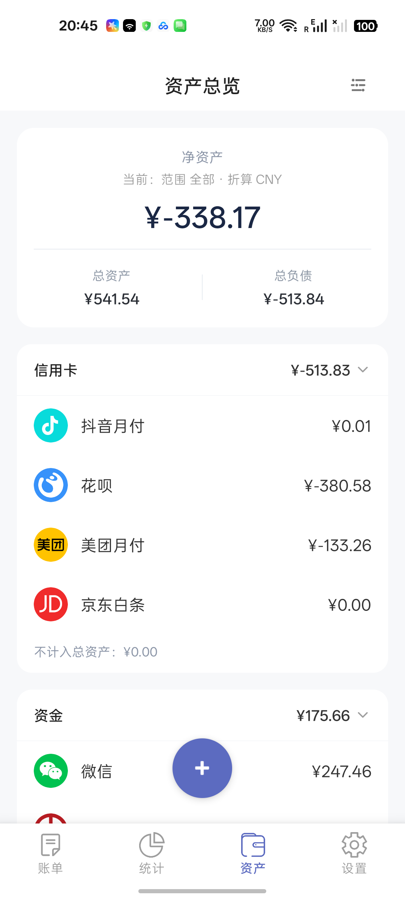
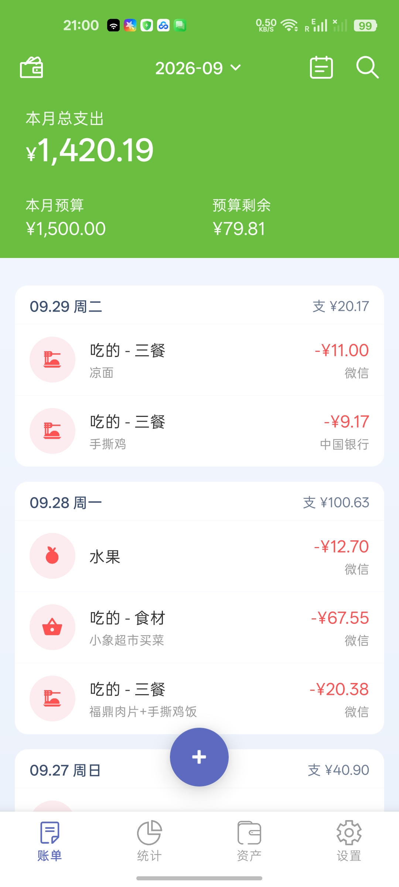

不舒服的点：
- 它不是贴在右下角，而是落在内容流中间，滚动时一直挡着某个条目，想点被挡住的行要点两次。
- 视觉上它是全屏最重的一块颜色，却压在数据上。
- 期望：贴右下角、列表留出底部 padding 让最后一屏也能滚上来。

---

### 2. 账单首页的绿色大块头，和全局品牌色打架

首页顶部一大片饱和绿（#4CAF50 附近），下面卡片里的 FAB、「记一笔」按钮、底部导航选中态全是靛蓝 #5C6BC0。同一个屏幕上两套主色互相抢。

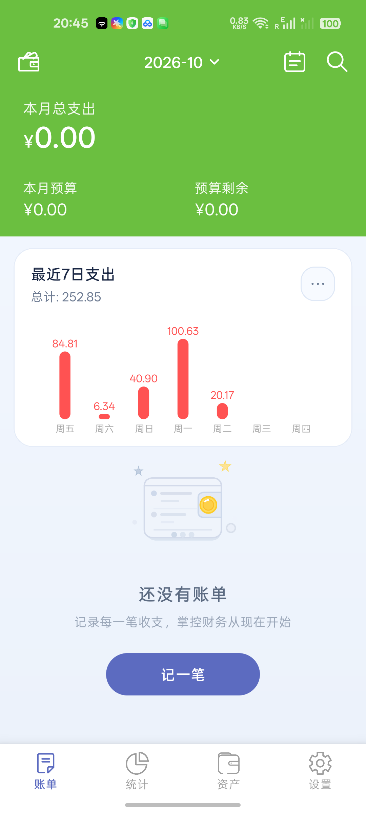

不舒服的点：
- 「记一笔」是页面最该被看见的按钮，却是蓝的，压在一个绿色大banner下面，绿色banner反而更像主操作。
- 绿色 banner 里三组数据（本月总支出 / 本月预算 / 预算剩余）全是白色同级排版，没有主次。

---

### 3. 预算快超支了，界面毫无反应

9 月预算 1500、已花 1420.19，只剩 ¥79.81（5%）。但「预算剩余 ¥79.81」和「¥1,500.00」一样是纯白普通文字，既没有变色、没有进度条、也没有一句提示。

不舒服的点：超支前兆是记账类 App 最该提醒的事，现在完全看不出来，得自己拿计算器。

---

## 二、看不懂 / 信息标错的地方

### 4. 汇率页把韩元显示成「≈ 0.00 CNY」

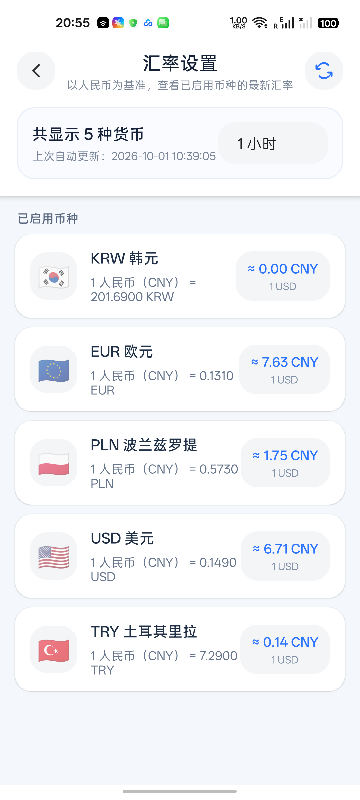

不舒服的点：
- KRW 那一行右边胶囊写着 **≈ 0.00 CNY**。左侧明明写着「1 人民币 = 201.6900 KRW」，也就是 1 韩元 ≈ 0.00496 元，但数值被四舍五入成两位小数就变成了 0.00，看起来像功能坏了。
- 更要命的是：五行的胶囊下面**全都写着「1 USD」**，但 KRW / EUR / PLN / TRY 行的数值其实都是"1 单位该货币 ≈ 多少人民币"。标签和数值对不上号。
- 另外这页的蓝色比全局品牌蓝明显更亮（偏纯蓝），和别处的靛蓝放一起像两套主题。

---

### 5. 资产页负数写法「¥-338.17」和账单页「-¥11.00」不一致

不舒服的点：
- 「¥-513.84」符号在人民币符号**后面**，而账单列表里一律是「-¥11.00」符号在前面。同一个 App 两种负数写法。
- 「总负债 ¥-513.84」本身就是负数，标题说"负债"、值又是负号，等于负负得正的暗示，用户得在脑子里算一次才明白。

---

### 6. 账单详情弹窗里「计入」是实心主按钮，语义不明

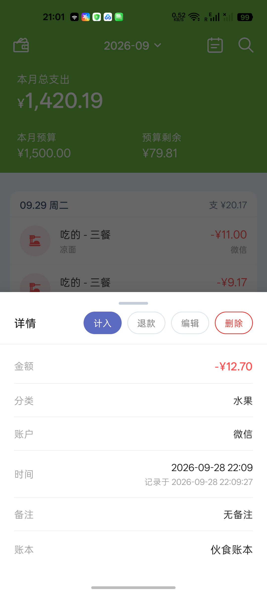

不舒服的点：
- 一排四个操作里，只有「计入」是实心填充，其余「退款 / 编辑 / 删除」都是描边。视觉上「计入」被抬成了这屏的主操作，但它其实是"是否计入统计"的一个开关状态，不是动作。
- 名字也只有「计入」两个字，看不出点完会变成什么（不计入？）。这种开关型操作更常见的写法是「计入统计 / 不计入」或者直接给个开关。

---

### 7. 月份选择器只能选 2026 年及以后

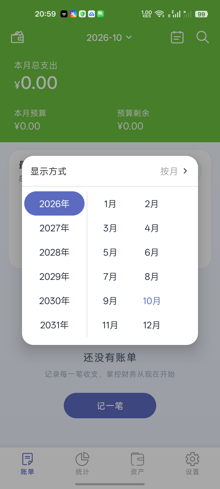

不舒服的点：年份从 2026 开始往下排，没有更早的年份、列表也不像能往上滑。如果以后（或别的账本）有 2025 年的账单，从这里走不到。

---

## 三、危险操作提示不一致

### 8. 备份页里两个"清空"按钮长得跟"导出"一样

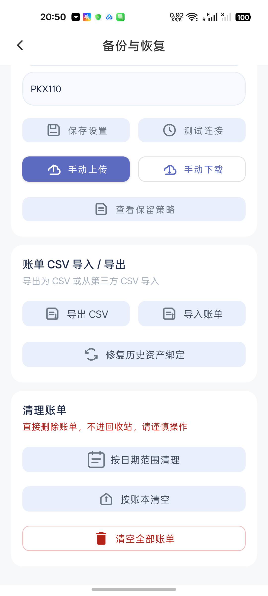

不舒服的点：
- 「按日期范围清理」「按账本清空」是**不可恢复的删除**，却用了和「导出 CSV / 导入账单」完全一样的浅蓝灰填充按钮，只有最后一个「清空全部账单」是红色描边。
- 三个按钮摆在一起，视觉危险度排序和实际危险度完全不对：真正的"全清"看着最像收尾项，另两个才该更警惕。

---

## 四、明知但还没做（交接文档里也记着）

### 9. AI 功能页三条分区色条颜色不统一

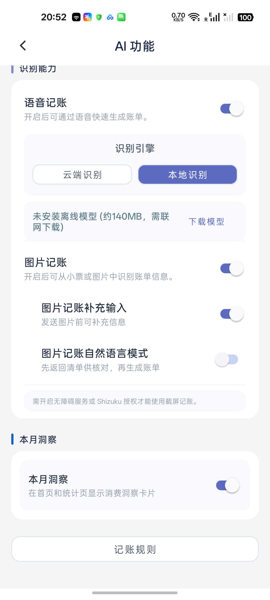

不舒服的点：「入口与卡片」「策略与规则」「本月洞察」是亮蓝，唯独「识别能力」是淡紫。**同一屏里能同时看到两种色条**（32_ai_2 那张最直观：上面淡紫、下面亮蓝）。用户已经说过要"对齐这几条的颜色"，这一条属于已知待办。

---

### 10. 主币种 CNY 的勾选是灰色的，看起来像被禁用

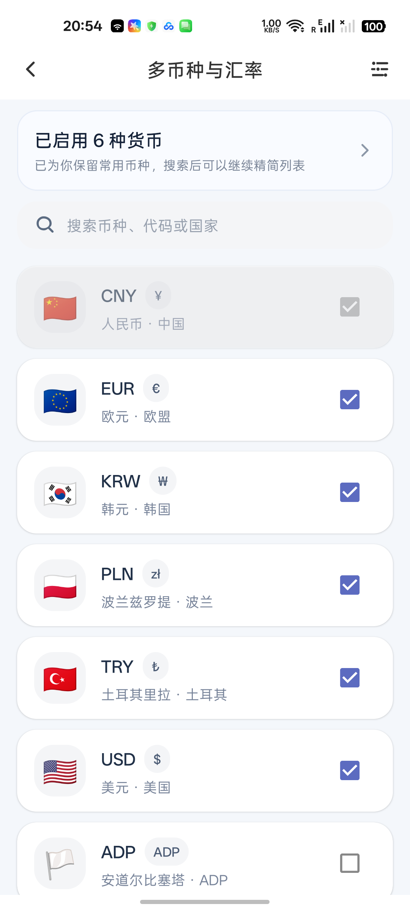

不舒服的点：CNY 那一行底色发灰、勾也是灰的，而下面所有已启用币种是靛蓝勾。灰勾在 Android 上等于"不可用"的通用信号，但 CNY 是主币种、恰恰是最重要的一个。

---

## 五、顺便记一笔：账户选择页里"不计入总资产"那行是灰字

不算问题，但和下面账本名的黑色对比偏弱，扫视时容易漏掉。优先级最低。

---

## 六、还没看的地方（下轮继续）

- 悬浮记账窗的键盘（含 `+ − × ÷` 那排）—— **本轮没能看到**：悬浮窗只能靠物理敲背板/翻转触发，`am broadcast -a ACTION_START_DOUBLE_TAP` 和 `-a com.taostudio.tapaccounting.SHOW_OVERLAY`（-p 包名定向）都发了、服务确实在跑（`dumpsys activity services` 显示 isForeground=true），但弹窗没出现；`am start-foreground-service -n .../.OverlayService` 被拒（`Requires permission not exported`）。下轮要么在机器旁真敲一次，要么在 App 里找个开发者入口。
- ~~记一笔录入页 + App 内键盘~~（11–13）、~~多选栏~~（14–15）、~~统计月/年视图~~（16–20）、~~资产子页：资产详情/收纳/对账/账本抽屉/账本总览~~（21–26）、~~设置→桌面小组件~~（27）、~~个人资料~~（附注）、~~回收站~~（28）、~~记账规则~~（29）
- 资产对账页里那个「余额调整」按钮的实际流程（没敢点，会创建调整记录）
- 悬浮窗 Service 里 inflate 的记账面板本身（不是 App 内那个，见上一条）

---

## 七、本轮新看到的页面（2026-10-01 深夜补录）

### 11. 「记一笔」里日期默认今天，和正在浏览的月份脱节

在 2026-09 的账单列表里点 + 记账，弹层里的日期默认是 **2026-10-01 21:28:09**（今天）。

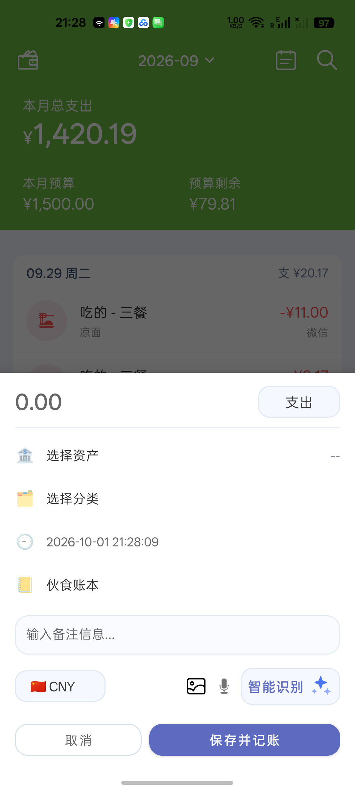

不舒服的点：
- 用户正看着 9 月的账，随手记一笔后账单落进 10 月，**返回 9 月列表根本看不到它**，第一反应是"记了没存上"。
- 月份选择器又只到 2026（见问题 7），10 月列表虽然能切过去，但"我在 9 月里记的账去哪了"这个疑惑没有任何界面提示兜底。

### 12. 金额键盘一弹出，「保存并记账」就被整个盖住

点金额框弹出自带键盘（7-9 在上的计算器盘 + `+ − ÷ ×` 一列），键盘直接把**备注栏、CNY、智能识别、取消/保存并记账**全部盖住。

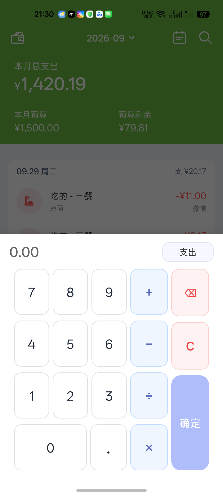

不舒服的点：
- 输金额的过程中完全看不到「保存并记账」按钮，必须先点键盘上的「确定」收起键盘才能保存。第一次用的人会在键盘上找"保存"。
- 键盘的「确定」本身就是一块实心大蓝按钮（有表达式时变成品牌蓝实心，视觉权重比真正的「保存并记账」还高），容易让人误以为点它就是记账完成。
- 顺带：键盘没弹出时点「保存并记账」，金额还是 0.00，按钮也不拦一下（未实测提交，按 0.00 可点推断，存疑）。

### 13. 切到「收入」时冒出一个红色描边的「账单退款」胶囊

类型下拉有 支出/收入/转账/还款 四项，菜单里**没有标记当前项**；选「收入」后金额变绿没问题，但「选择分类」那行右侧出现一个**红色描边红字的「账单退款」胶囊**。

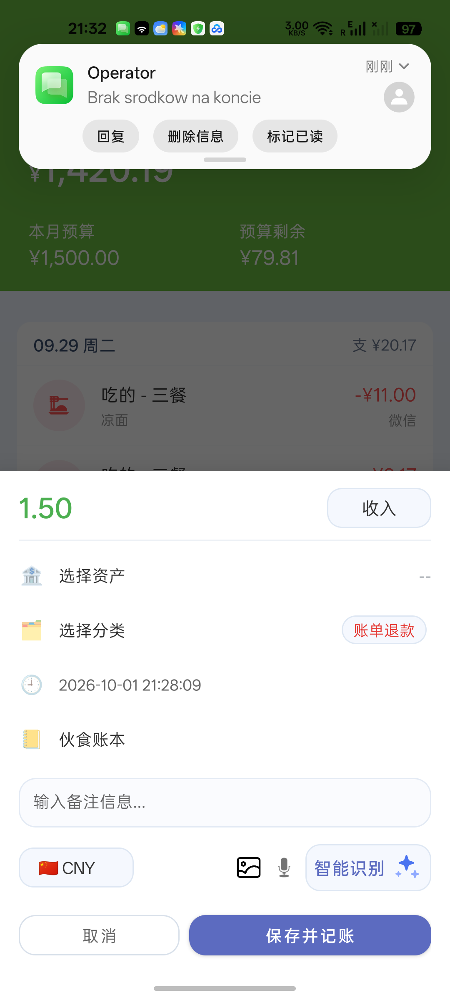

不舒服的点：
- 全 App 的语义是"收入=绿、红色=支出/危险"，在收入模式下突然出现一个红色胶囊，看起来像出错或欠费提醒，而不是一个可选的快捷分类。
- 弹出菜单里没有勾选/高亮当前类型，用户对不上"我现在在哪一项"。

---

### 14. 多选模式里，「已选几笔」这个关键状态几乎无处可见

长按账单进入多选：每行左侧出现复选框，底部浮出「退出多选 / 全选 / 移动 / 删除(1)」操作栏。

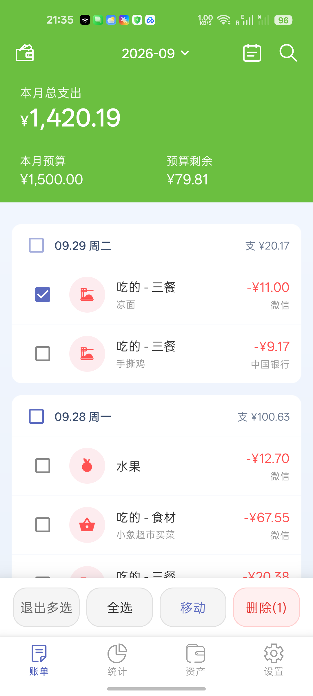

不舒服的点：
- 顶部那块月度统计（本月总支出 ¥1,420.19）**原样不动**——没有任何标题栏变成"已选 1 笔"的状态条。用户在多选和浏览两种模式间切换时，屏幕上半部分毫无变化，只有行左侧多了复选框，容易意识不到自己已经进入多选。
- 已选数量唯一的展示是底部「删除(1)」括号里那个数字，视线在列表里时感知不到。
- 多选模式下点账单行 = 切换选中（不是看详情），第一次用会习惯性点进去看详情，结果反而选中了一条，也没有任何说明。

### 15. 多选「移动」弹窗文案是清楚的（正面记录，附一个小缺）

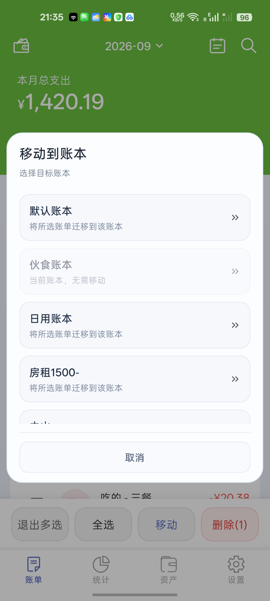

弹窗里有标题「移动到账本」、副标题「选择目标账本」，当前账本置灰显示"当前账本，无需移动"，逻辑清楚。唯一小缺：整屏没有一句"将移动 1 笔账单"，批量场景下用户不知道影响范围。
另外这个弹窗里「删除(1)」是浅红底描边、有危险感 —— 和备份页问题 8 里"清空按钮像普通按钮"形成反差，这个做法是对的。

---

### 16. 支出分类饼图：小分类整个消失，中心金额和顶部对不上账

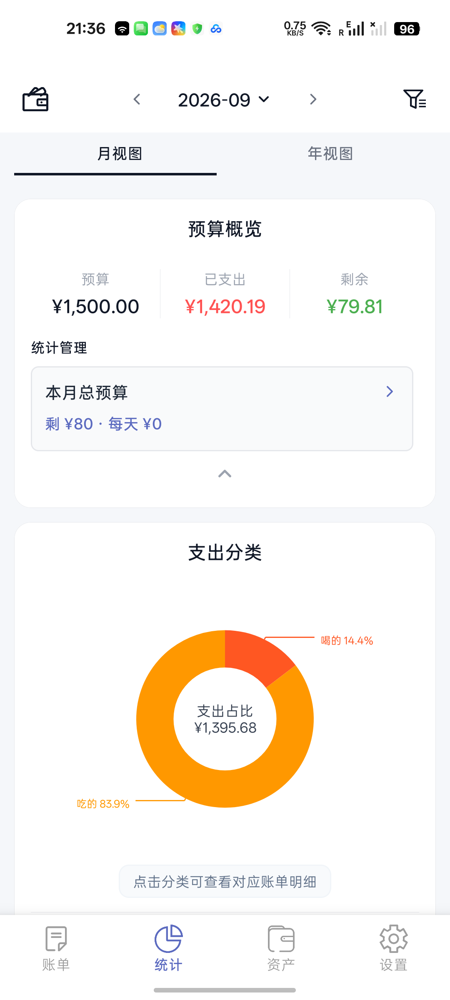
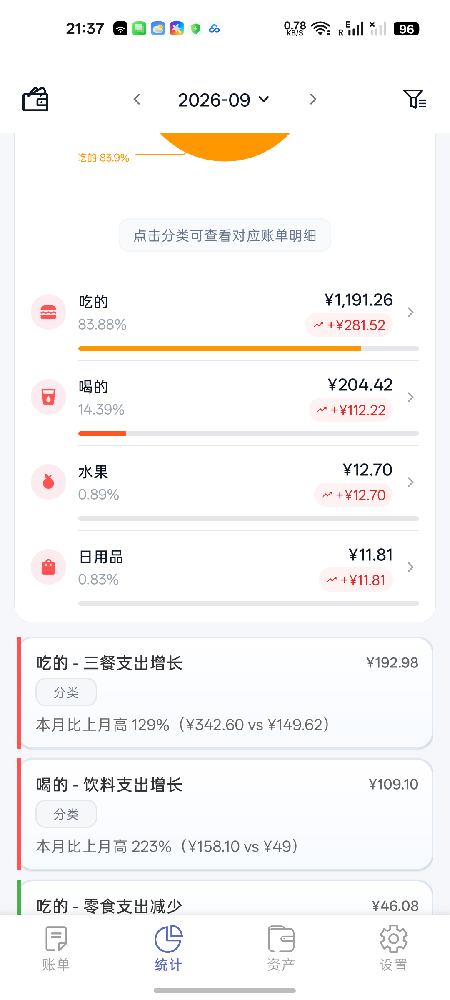

9 月支出分类里，饼图只画了「吃的 83.9%」和「喝的 14.4%」两个扇区，中心写着 **支出占比 ¥1,395.68**。但：
- 顶部 banner 说本月总支出 **¥1,420.19**，下面的明细列表也确实列出了 4 项（水果 ¥12.70、日用品 ¥11.81）。**这两项合计 1.7% 在饼图里连扇区都找不到**，中心金额 1,395.68 恰好 = 吃的+喝的。
- 用户拿中心数字对顶部数字对不上（差 ¥24.51），没有任何解释。饼图的中心数看起来更像"已画出来的扇区之和"，而不是全部支出。
- 附带：图下方常驻一条灰色胶囊「点击分类可查看对应账单明细」，看起来像一个可点的按钮，其实只是说明文字。

### 17. 预算概览里「每天 ¥0」看不懂，两种精度混用

预算概览卡：预算 ¥1,500.00 / 已支出 ¥1,420.19 / 剩余 ¥79.81（这行颜色语义是对的）。往下「统计管理」里写着 **剩 ¥80 · 每天 ¥0**：
- "每天 ¥0"完全读不懂——是"今天还能花 0 元"？9 月已经过完了所以每天 0？没有任何说明，看起来像坏了。
- 同一屏「剩 ¥80」和上面「剩余 ¥79.81」：一个取整、一个精确，同一页两种精度，扫一眼像两个数。

### 18. 洞察卡片：同为"支出增长"，色条却一条红一条橙

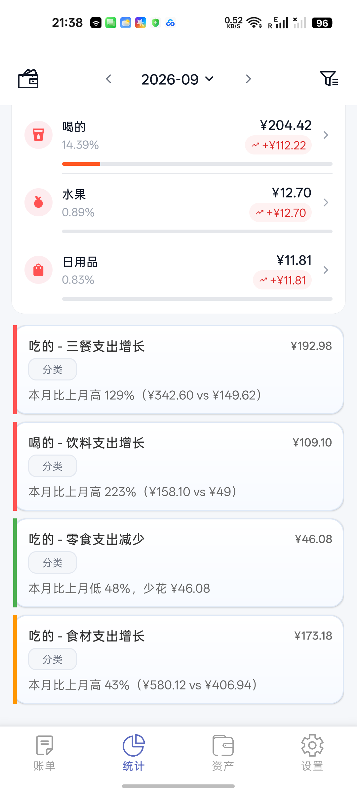

底部四张洞察卡：三餐增长=红条、饮料增长=红条、零食减少=绿条、**食材增长=橙条**。
- 如果色条表示涨跌，"增长"应全红；如果表示分类，三条"吃的"家族的颜色又不统一。同一个页面里语义混乱（和 AI 页问题 9 的"两种色条"是同款毛病）。
- 每张卡右上角的金额（¥192.98 / ¥109.10…）没有标签，用户得自己心算才知道它是"本月−上月的差值"；而减少卡里这个数又和正文"少花 ¥46.08"重复出现。

---

### 19. 年视图的预算概览：标签还写着「本月」，全年数字没名分

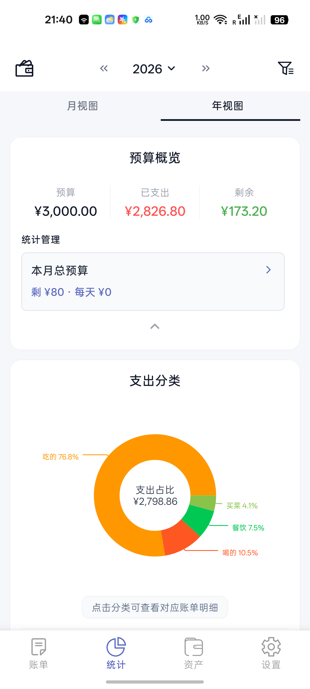

切到「年视图」后头部还是那张"预算概览"，数字变成了全年的（预算 ¥3,000.00 / 已支出 ¥2,826.80 / 剩余 ¥173.20），但里面的小卡标题依然是 **「本月总预算」剩 ¥80 · 每天 ¥0**。用户在年视图里读到"本月"两个字会怀疑自己切错了页。
年饼图中心 ¥2,798.86 与已支出 ¥2,826.80 同样对不上（问题 16 的年视图版本：水果、日用品、居家、其他没画进扇区，中心只等于已画出的那几块）。

### 20. 年视图被「↗ +全额」红色胶囊刷屏

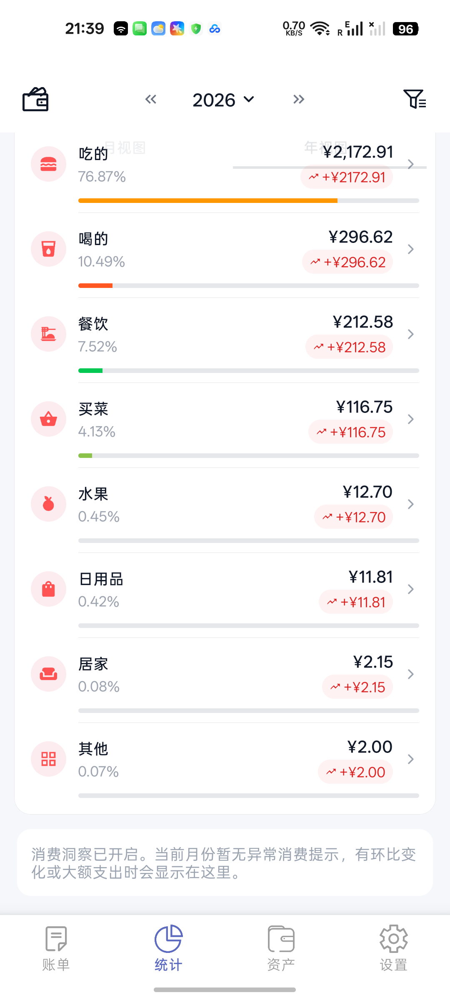

2026 是只有今年的账本，每个分类的环比都是"从 0 涨到全额"，于是**每一行都挂着一个比自己金额还大的红色「↗ +¥xxxx」胶囊**（吃的那行 +¥2172.91 比主金额还长）。满屏红色增长提示，视觉噪音远大于信息量；年视图甚至没有年度总支出/收入的汇总头部，直接就是分类列表。

---

### 21. 资产详情里的「收纳」开关：一碰就生效，没人知道它是什么

微信账户详情，余额下方并排「对账 | 收纳」两个词。点了「收纳」之后：

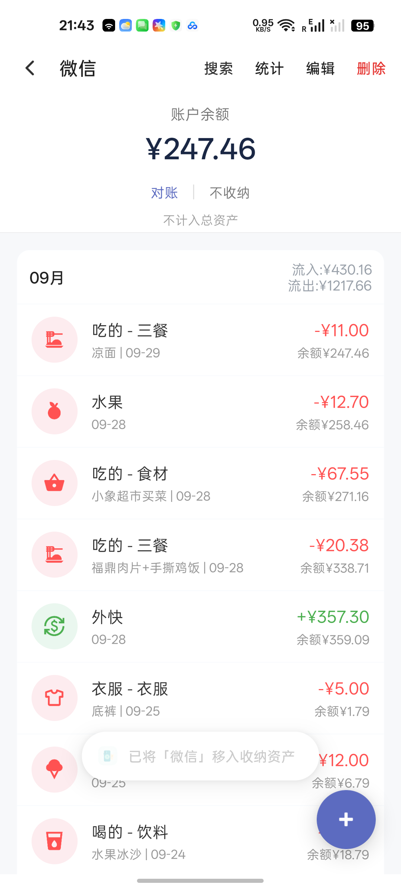

不舒服的点：
- **一碰就立即生效**，toast「已将「微信」移入收纳资产」，账户随即变成"不计入总资产"（净资产 ¥-338.17 里这项就没了）——没有任何确认、说明或撤销入口。我这次审查时自己就误触了一次，普通用户只会更懵。
- "收纳"这个词完全不自明，普通用户的心智里它≈"整理/收起来"，实际含义是"**从总资产里剔除**"。要等切过去看到那行灰色小字「不计入总资产」才明白。
- 它和左边「对账」长得像同一种 tab（对账=看流水页面，收纳=账户属性开关），两类完全不同的东西并排放在同一行按钮位，样式还相似。
- **同一个属性在编辑页里叫另一套名字**：点「编辑」进"修改资产"页，同样的开关叫「计入总资产」(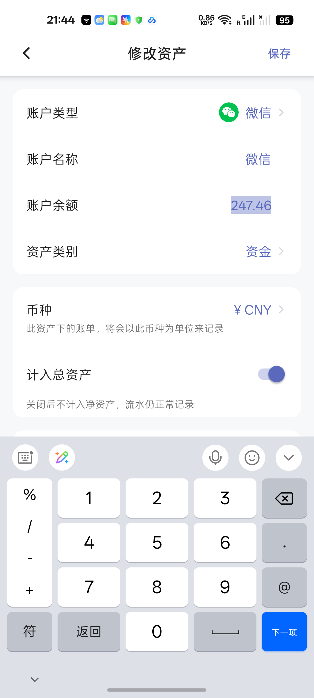)，还带着解释"关闭后不计入净资产，流水仍正常记录"。也就是说详情页的"收纳/不收纳" = 编辑页的"计入总资产开/关"，一个开关两种话术，说明文案其实写得出（编辑页就写了），详情页却用了最自作聪明的一个词。
- 恢复后 toast 是「移出收纳资产」，操作是可逆的，但"移入/移出"的方向感又得猜。

### 22. 顶栏红色「删除」平铺在一级导航里

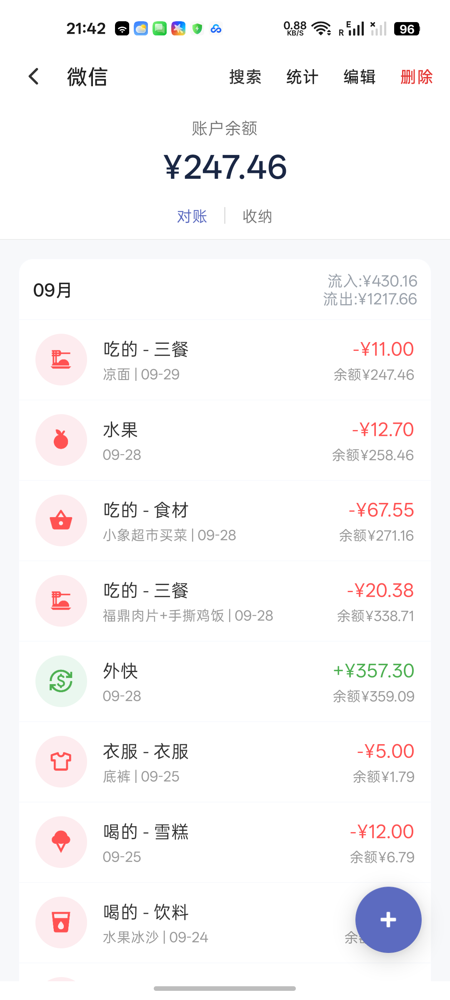

账户详情顶栏是「搜索 统计 编辑 删除」并排，「删除」是红色字，删的是**整个账户**（连同它的全部流水、余额轨迹）。这是本页后果最重的操作，却和最常用的「搜索」并排坐在右上角，中间只隔一个词。红字有警示，但没有位置上的隔离——用户整理账户时来回点"编辑/统计"，手滑碰到"删除"的概率不低。（观感记录，未点击。）
顺带：「对账」这个 tab 名和它的实际内容（逐笔流水+余额轨迹）对不上，普通用户的"对账"预期是和银行核对余额。

---

### 23. 资产对账页：不填数字时整页像出了错

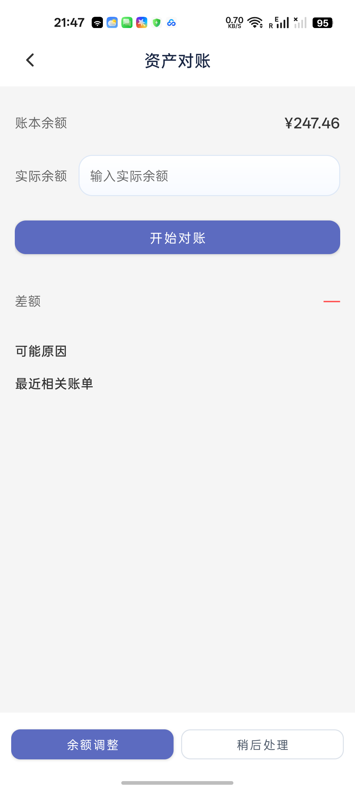

刚进「资产对账」什么都没输时：差额位是一根**红色横杠**，下面「可能原因」「最近相关账单」两个标题下面全是空白。三块内容在还没算出任何东西时就全部露出，红杠+空标题让页面看着像"出错了没加载"，而不是"等你输入"。

### 24. 「可能原因」列表：数字吓人，和差额毫无关系

输入实际余额 250 后差额 +¥2.54（这个计算和绿色"多出"的语义是对的），但「可能原因」给出：

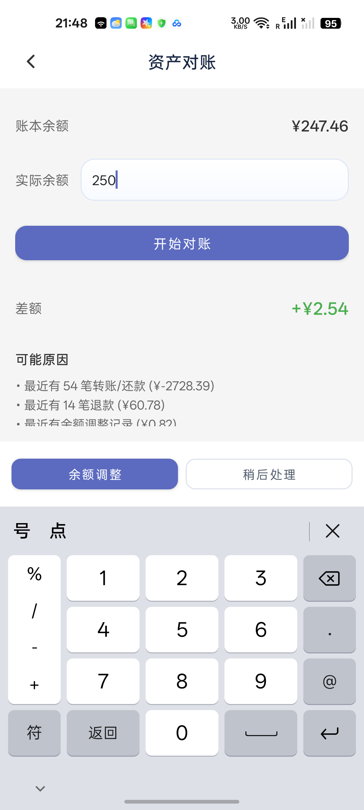

- 「最近有 54 笔转账/还款 (¥-2728.39)」「最近有 14 笔退款 (¥60.78)」「最近有余额调整记录 (¥0.82)」。
- 这些条目跟 2.54 的差额**看不出任何因果**——54 笔转账是什么？¥-2728.39 是什么口径？既不能点开看明细，也没有一句"这些变动可能没记进账本"。普通用户看到只会更慌，不会更明白。
- 第三条直接被裁掉一半，页面下面就是系统键盘（App 内输入金额的场合没换成干净数字盘，跟"记一笔"的自带键盘是两套体验）。

---

### 25. 账本抽屉：「默认账本」是蓝字，但「当前」徽章却在另一项上

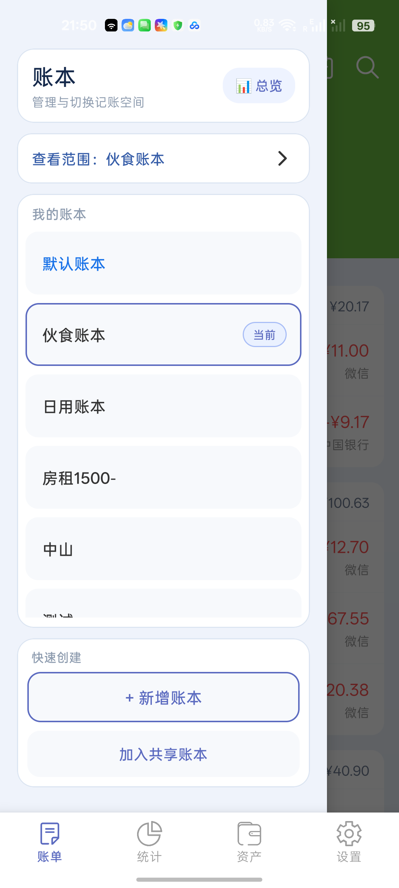

账单页左上角钱包图标打开账本抽屉：头卡「账本 / 管理与切换记账空间」+ 右上「总览」胶囊，下面「我的账本」是 默认账本 / 伙食账本（蓝框 +「当前」徽章）/ 日用账本 / 房租1500- / 中山 / 测试…，底部「+ 新增账本」「加入共享账本」。

不舒服的点：
- **「默认账本」四个字是蓝色的**，而真正在用的「伙食账本」是黑字蓝框 + 白底蓝字「当前」徽章。蓝色在别处都是"当前/可点"的信号（品牌蓝），这里却用蓝色去标一个非当前项，用户第一眼会以为默认账本是选中的。
- 抽屉里的「当前」徽章是**白底蓝框蓝字**，到了账本总览页同一个徽章变成**深色半透明胶囊**叠在色块上（见 26）。同一个"当前"两处两样。
- 列表项只有账本名字，没有账单数/金额，切换前对"这个账本里有多少账"零信息量，得先退回再进"总览"才看得到。
- 「查看范围：伙食账本」这行和"当前"徽章表达的是同一件事（当前在哪个账本），用了两套说法，且"查看范围"这个词本身含义模糊（是账本？是日期范围？）。

### 26. 账本总览：每张卡顶部是一大块纯色，色块比信息还多

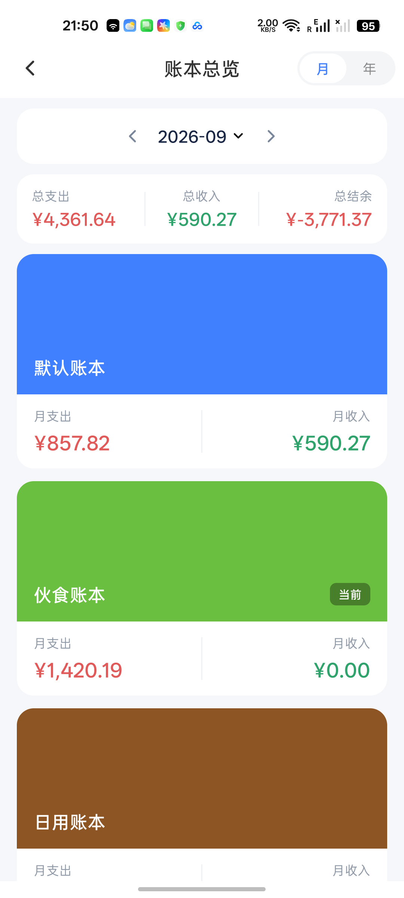

总览页 = 月/年切换 + 一行汇总（总支出 ¥4,361.64 红 / 总收入 ¥590.27 绿 / 总结余 ¥-3,771.37 红）+ 每个账本一张大卡：卡头是一整块**纯色大色块**（默认账本=蓝、伙食账本=绿、日用账本=深棕…），色块里只有账本名一行字，卡头占卡片近一半高度，下面才是「月支出 / 月收入」。

不舒服的点：
- 卡头色块面积巨大、承载信息极少，一屏两张卡就占了满屏，数字（月支出/月收入）要滚很久才看完；颜色（蓝/绿/棕）之间没有可读的语义，看着像随机上色。
- 「月收入 ¥0.00」用饱和绿色显示：一个 0 值还被涂成"好"的绿色，比「月支出 ¥1,420.19」的红字还抢眼。
- 顶部汇总里的「总支出 ¥4,361.64」也是大红字——整页红色数字偏多，像在报警而不是在展示数据。
- 顺手记一个跨页不一致：同样的"月/年"切换，统计页是**下划线文字 tab**（月视图/年视图），总览页是**白底胶囊组**（月/年），两页两种控件形状。

---

### 27. 桌面小组件页：一片空白，不给预览也不给一键添加

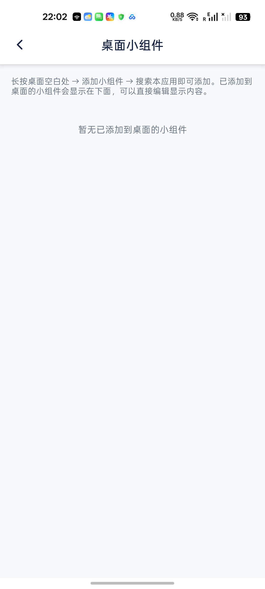

设置 → 桌面小组件，整页只有：顶部一段灰字说明「长按桌面空白处 → 添加小组件 → 搜索本应用即可添加……」，然后一句「暂无已添加到桌面的小组件」，剩下 4/5 屏全白。

不舒服的点：
- **没有小组件长什么样的预览/示意图**——用户冲着"总支出、预算、预算剩余在桌面一眼可见"进来，看到的是一片空白页，什么都判断不出来。
- 整个"怎么加"的动作全压在文字描述上，页面上**没有一个「添加小组件 / 去桌面添加」按钮**；照着做要离开 App 去桌面长按，中途很容易放弃。
- 说明里说"搜索本应用"但没告诉用户搜什么词（App 名？包名？），照做的人多半卡在这一步。
- 两级浅灰字（说明字 + 空态字）压在白底上都很弱，空态文案位置偏上、下面全留白，整体看着像"页面没加载出来"。

---

### 28. 回收站：62 条已删账单，和正常账单长得一模一样

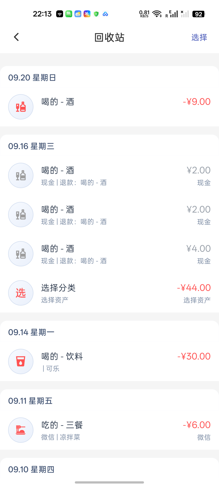

回收站按日期分组列出已删账单，行样式和账单列表几乎相同：白底、黑标题、右边红色金额（-¥9.00）、下面灰色小字备注/账户。

不舒服的点：
- **除了标题栏，没有任何"已删除"的视觉标记**——没有删除线、没有"已删除"灰标、没有垃圾桶提示，金额还是和正常支出一样的红色，往下滚几屏很容易把回收站里的条目当成真账单（甚至当成"我还有这笔支出"）。
- 分类图标在回收站里是**灰度**的（🍷 变灰瓶），正常列表是彩色 emoji；既没有说明为什么变灰，也和别的页面的图标观感不一致。
- **只有账单的日期（09.20 / 09.16…），没有"删除于"时间**。62 条混在一起时，想找回"我刚刚删错的那笔"只能凭账单日期和记忆去猜，缺少"按删除时间倒序"这个真正有用的排序。
- 列表里还留着「选择分类 / 选择资产」这种占位文案的行（未分类无资产的测试账单），排在正式条目中间，像脏数据漏进了用户界面。

### 附：设置 → 个人资料（无问题，备注免得下轮重复看）

点头像卡片直接弹「编辑个人资料」：头像（右下角蓝色铅笔角标 + "点击头像更换图片"）、你的名字、头像下方文案、取消/保存（蓝字）。排版清楚、留白舒服，**本轮没找到别扭的地方**。唯一可提的小点：主操作「保存」只有蓝字没有实心底，和其他页"主按钮实心填充"的规格不一致。

---

### 29. 记账规则页：规则详情像"没填完的表单"，底部按钮还压着最后一条

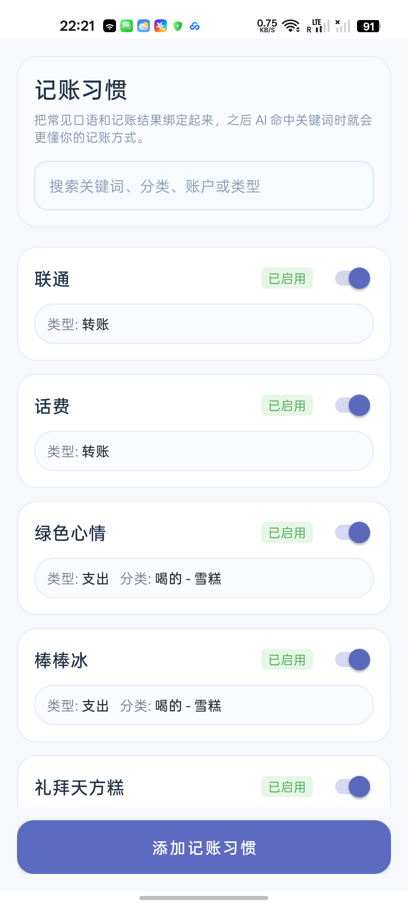

AI 功能 → 记账规则，进的是「记账习惯」列表：顶部说明"把常见口语和记账结果绑定起来"，下面每条规则一个卡片（联通 / 话费 / 绿色心情 / 棒棒冰…），右侧「已启用」绿徽章 + 开关，卡片内一条**浅灰圆角条**写着「类型: 转账」「类型: 支出 分类: 喝的 - 雪糕」。

不舒服的点：
- **规则内容用浅灰圆角"输入框"样式呈现**，底色和 placeholder 几乎一样，看着像一条还没填完的表单，用户会怀疑"这规则是不是没保存好"，也想点进去改（其实它只是只读摘要）。
- 每行右侧已经有开关在表达启停状态，旁边再加一个绿色「已启用」徽章，信息重复，还占位置。
- 底部固定的实心大按钮「添加记账习惯」**压住了列表最后一条规则**（"礼拜天方糕"只露出标题），和首页 FAB 压内容是同一类毛病：列表底部没有留出按钮高度的 padding。

### 30. 10 月空态说"还没有账单"，上面却挂着"最近7日支出 252.85"

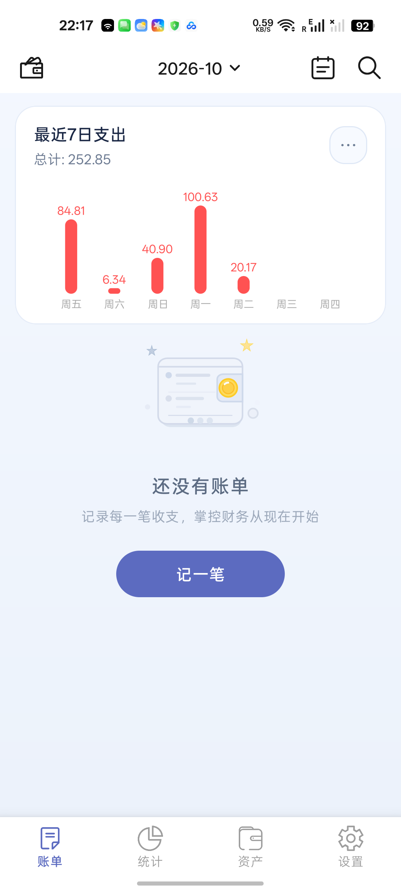

切到 2026-10（本月）时，同一屏上半部分是「最近7日支出 总计: 252.85」的柱状图（周五 84.81、周一 100.63…），下半部分是空态插画「还没有账单 / 记录每一笔收支，掌控财务从现在开始」。
- 用户第一反应是"到底有没有账单"：趋势卡明明有 252.85 的支出，空态却说这个月没有账单（其实那 7 天大多落在 9 月底）。两张卡放在一起互相打脸，没有一句"近7日跨月统计"之类的说明。

---

### 31. 「快捷记账准备」页：说"已准备 2/2"，下面却还有"建议确认 / 去开启"

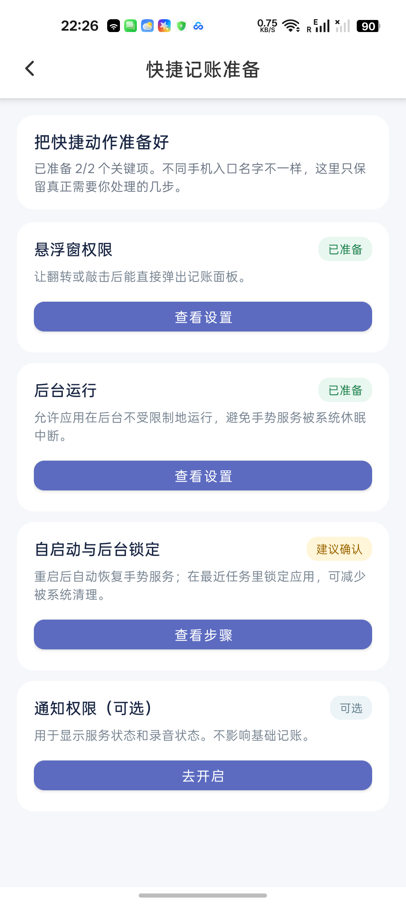

从 手势设置 → 敲击选项 → 保活与权限 →「查看快捷记账准备项」进来：头部大字「已准备 2/2 个关键项。不同手机入口名字不一样，这里只保留真正需要你处理的几步。」下面四张卡：悬浮窗权限（绿「已准备」）+ 查看设置、后台运行（绿「已准备」）+ 查看设置、自启动与后台锁定（黄「建议确认」）+ 查看步骤、通知权限（灰「可选」）+ 去开启。

不舒服的点：
- 顶部说"已准备 2/2"，可下面还杵着两个明显要你动手的按钮（「查看步骤」「去开启」）。用户会困惑"到底是好了还是没好"，得读完四张卡自己判断哪两个算关键项。
- 和第 27 条是同一族毛病：**整页没有"试试看"**——用户在这页确认完一切，仍不知道敲一下背板到底会弹出什么样子，得退出 App 去桌面上真敲一次。

---

## 过程记录（给下一个人）

- **本轮补充的操作教训**（别再踩）：
  - **每一步只 tap 一次**。`tap.ps1 -Name` 已经截完图后，不要顺手再补一个 tap：我补的那一下直接落在已关闭的底层页面上，误开了记账弹层和一笔账单详情。
  - **截图是 1080x2400，但工具展示给我的图是 900x2000，换算要 ×1.2**。我按 1.0 点过一次菜单项，结果点在菜单外面，白绕一圈。
  - **设备息屏会误报"ASLEEP"**：shot.ps1 用"文件 >2MB"判黑屏，停在桌面时壁纸 PNG 有 3MB，于是误以为屏幕灭了。判断用 `dumpsys power | grep mWakefulness` 更靠谱。
  - 本轮误触过一次「收纳」开关（资产详情页余额下方），已点回恢复，toast「已将「微信」移出收纳资产」为证，账户余额没变。
  - 中文从 dump 里读出来是乱码，`.tmp/rows.txt` 用 `Get-Content -Encoding UTF8` 仍乱码，但坐标可用；`.tmp/dumphier.py`（按字节从 `.tmp/ui.xml` 提 text/class/bounds）比 findtext.py 稳，正则要注意属性顺序里 `resource-id` 夹在 `text` 和 `class` 之间。
  - 旧结论：10 月无账单数据，看账单详情/多选记得在月份选择器（525,182）切到 2026-09。

- **误操作已恢复**：第一次进备份页时页面处于滚动状态，我按 HANDOFF 记的旧坐标盲点，误把「启用多币种功能」从开改成关，已用 uiautomator dump 取到 switch 的真实 bounds（center 916,1558）点回去，现在确认 `checked=true`（截图 `06_settings_fixtoggle.png` 可见开关是蓝色打开状态）。
- **截图分辨率是 1080x2400 原生**，HANDOFF 里"截图宽 461px、坐标乘 2.343"那条已过期；直接按 1080x2400 估算即可。
- **点之前一定要 dump**：`adb shell uiautomator dump /sdcard/ui.xml` + `adb pull`，再算 center。`.tmp/findtext.py`、`.tmp/findswitch.py` 可直接复用（UTF-8 输出注意设 `$env:PYTHONIOENCODING`）。
- **首页 dump 会失败**（`could not get idle state`，图表在动），这时按截图比例估算坐标点。
- **10 月无数据**，要看账单详情/多选请切到 9 月（月份选择器在顶部正中，实测 (525,182)）。
