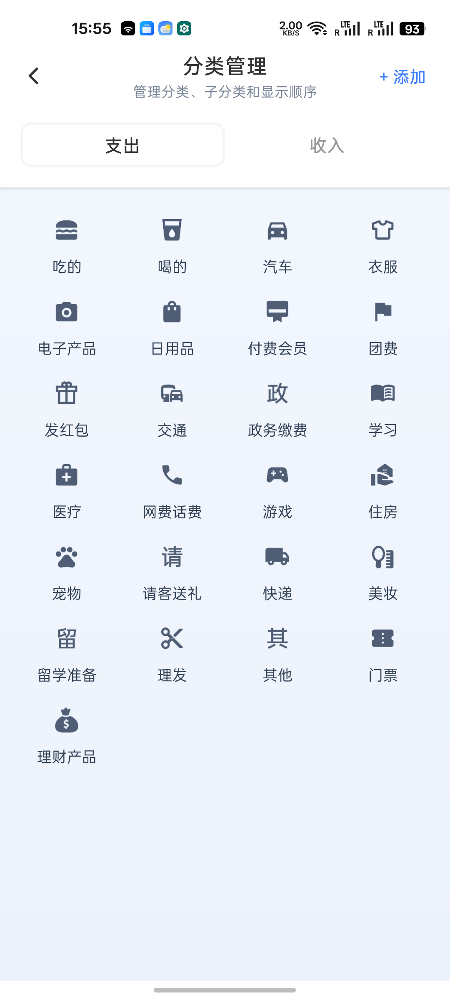
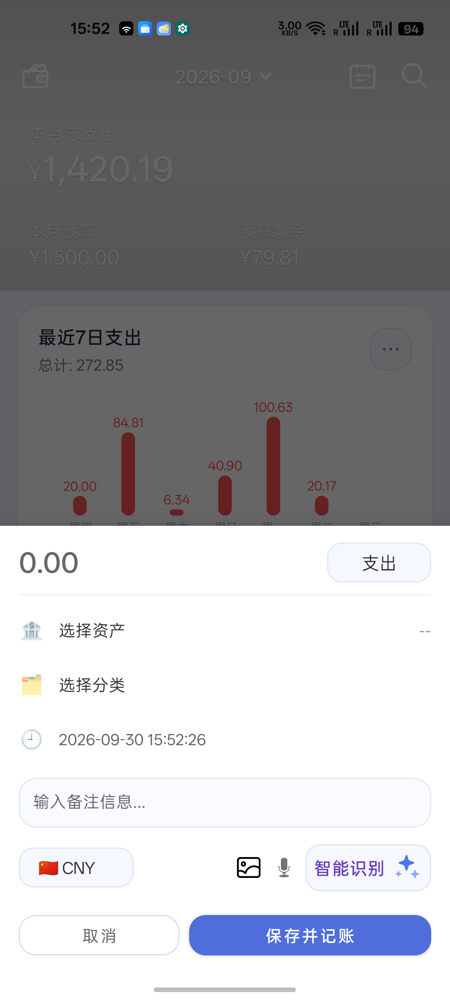
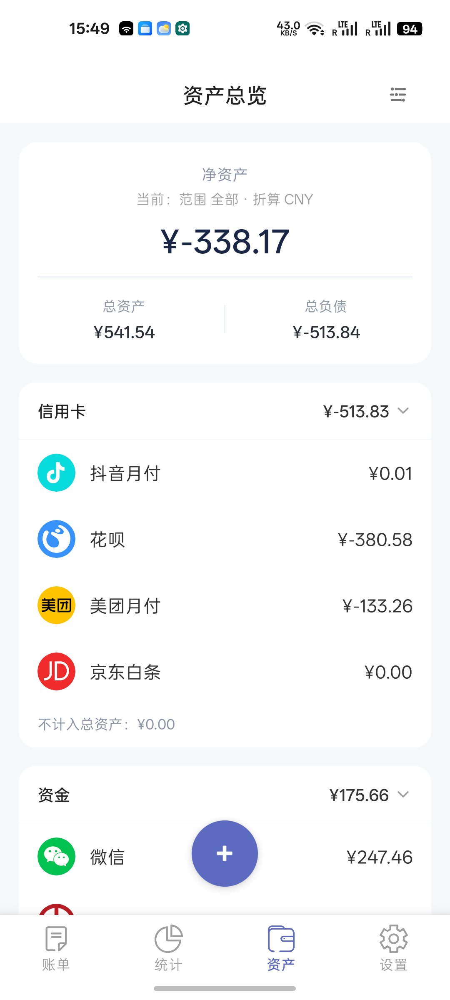
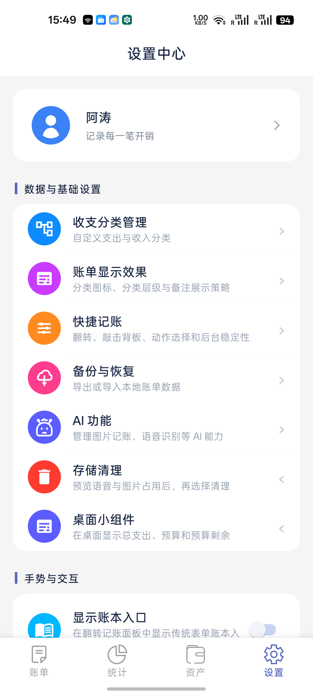
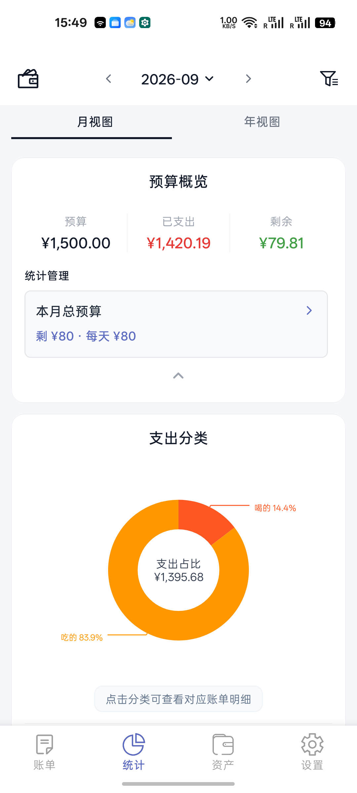
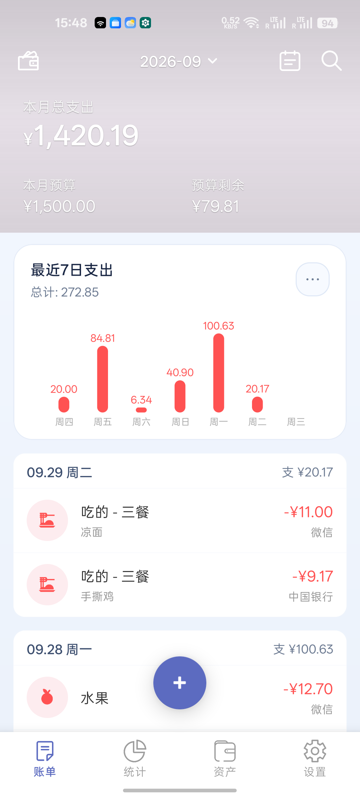

# UI 一致性审计报告

**项目**：TapTapAccounting（`com.taostudio.tapaccounting`）
**审计范围**：`app/src/main/res`（164 layout / 403 drawable）+ 30 个 UI 页面源码
**真机验证**：OnePlus 8T，1080×2400，density 454，Android 16，浅色模式
**日期**：2026-09-30
**性质**：只读审计。未修改任何代码或资源文件。本目录为唯一新增内容。

---

## 0. 审计方法

三条独立证据链交叉验证，避免只看代码下结论：

1. **静态扫描** — 对 164 个 layout、403 个 drawable、30 个 Kotlin 页面做穷举统计（硬编码值、色值分布、token 使用率）
2. **真机截图** — 无线 ADB 抓取 10 个页面实际渲染效果（见 `screenshots/`）
3. **像素采样** — 从截图像素反推真实渲染色值与 WCAG 对比度。**这一步推翻了我最初的几个判断**（见 §7），下文所有色值均为实测，非代码推测

> 采样脚本 `px.ps1` / 截图脚本 `shot.ps1` 保留在本目录，可复现。

---

## 1. 结论摘要

你的直觉是对的，而且比"有点旧"更严重：**这个 App 里同时存在两套互相冲突的设计系统**，不是一个旧系统慢慢在退化。

| 指标 | 实测值 | 健康值 |
|---|---|---|
| 承担"品牌主色"的不同蓝色 | **12 种** | 1 种 + 2–3 阶 |
| 金额格式化实现 | **15+ 套** | 1 套 |
| 图标视觉语言 | **5 种** | 1–2 种 |
| 顶部栏实现 | **5 种** | 1 种组件 |
| Tab/分段控件 | **3 种** | 1 种 |
| 字号 | **24 种**（含 3 个非整数/单位错误） | 8–10 种 |
| 圆角 | **21 种**（token 使用率 5.2%） | 4–6 种 |
| 次级文字灰 | **18 种** | 3–4 种 |
| 危险/支出红 | **13 种** | 1–2 种 |
| 页面背景灰 | **7 种** | 1–2 种 |
| 深色模式覆盖 | **仅 Chat 页 + 小组件**（55 行 vs 213 行） | 全量 |
| 复用 App 自定义 `<style>` 的 layout | **3 / 164（1.8%）** | >60% |

**最关键的一条**：你的头部主题色是**按账本（Book）自由配置的 16 色调色板**，而 App 内所有其他强调色（FAB、底栏、主按钮、开关）是写死的蓝。**换一本账本，首页就换一种颜色，但按钮永远是蓝的。** 这就是"不统一"的总根源，其余 90% 的不一致都是它的衍生。

---

## 2. P0 — 建议优先处理

### P0-1　品牌色：12 种蓝同时存在

实测像素值（从截图采样，非代码推测）：

| 实测色值 | 用在哪 | 来源 | 是否 token |
|---|---|---|---|
| `#5C6BC0` | FAB、底栏选中、账单详情"计入"、弹窗主按钮 | `colors.xml:26` `brand_primary` | ✅ |
| `#4F6EDB` | 记账弹窗"保存并记账" | `layout_floating_window.xml:557` 硬编码 | ❌ |
| `#4F6DFF` | 所有开关打开态轨道 | `color/switch_track_tint.xml:3` 硬编码 | ❌ |
| `#4080FF` | 首页头部底色（默认账本） | `BookAccountManager.kt:26` 调色板[0] | ❌ |
| `#1A73E8` | 悬浮窗"切换到 AI 对话" | `layout_floating_window.xml:568` 硬编码 | ❌ |
| `#1A56CC` | 桌面小组件强调色 | `colors.xml:199` | ⚠️ 独立定义 |
| `#5B8DEF` | 设置页图标徽章蓝 | `colors.xml:158` | ⚠️ 独立定义 |
| `#2196F3` | 资产页 FAB 色调 | `colors.xml:144` | ⚠️ 独立定义 |
| `#2563EB` | Chat 链接色 | `colors.xml:70` | ⚠️ 独立定义 |
| `#4F7DF3` | 统计页成员头像本地 | `colors.xml:176` | ⚠️ 独立定义 |
| `#7C4DFF` | AI 强调色（紫） | `colors.xml:40` | ⚠️ 独立定义 |
| `#0D8BFF` | 设置页蓝色徽章 | `drawable/bg_icon_badge_blue.xml:5` | ❌ |

**最能说明问题的一处**：`#4F6EDB`（保存按钮）和 `#4F6DFF`（开关）只差 1 个色阶，肉眼无法分辨，但它们是两个不同的值。这是典型的"每次改一处、复制一份"漂移结果——**说明连作者自己都没意识到它们本该是同一个颜色**。

**另一处**：`values/colors.xml:4-8` 还留着 Material 原始色 `colorPrimary #3F51B5` / `colorAccent #FF4081`，与 `brand_primary #5C6BC0` 并存。

**建议**：定死 `#5C6BC0` 为唯一品牌色。其余 11 个全部映射过去，或明确降级为"语义色"并写进文档。开关/按钮这两处硬编码优先改（影响面最大）。

---

### P0-2　金额格式化：15+ 套实现，同一个数字两种写法

这是最直接破坏"专业感"的问题，**用户一眼就能发现**。

**实测证据**（`screenshots/calendar.png`）：同一个日历网格里，9 月 15 日显示 `-13`，9 月 24 日显示 `-20`，而其他日期显示 `-89.81`、`-107.26`。

**根因**：两套格式化并存

```kotlin
// AmountFormatHelper.kt:16  —— "规范"实现，永远两位小数
fun formatAmount(amount: Double, useGrouping: Boolean = ...) =
    String.format(Locale.getDefault(), if (useGrouping) "%,.2f" else "%.2f", amount)
// → 13.0 渲染成 "13.00"

// AccountingFormController.kt:1659  —— "紧凑"实现，抹掉末尾零
private fun formatCompactDecimal(value: Double) =
    String.format(Locale.getDefault(), "%.4f", value)
        .trimEnd('0').trimEnd('.')
// → 13.0 渲染成 "13"
```

**这个模式在 6 个地方各写了一遍**（`AccountingFormController.kt:1659`、`InvestmentLotManagerDialog.kt:222`、`InvestmentLotSplitDialog.kt:506`、`AssetDetailActivity.kt:1478`、`AddAssetActivity.kt:880`，以及日历格内自己的一套）。

**完整清单**（每个都是独立实现）：

| 文件:行 | 函数 |
|---|---|
| `AmountFormatHelper.kt:16,21` | `formatAmount` / `formatCurrency` ← **唯一应保留的** |
| `data\BillDisplayFormatter.kt:93` | `formatMoney` |
| `logic\CurrencyUtils.kt:8` | `formatAmount` |
| `logic\insight\InsightEngine.kt:357` | `formatAmount` |
| `ui\activity\BillDetailActivity.kt:789,799` | `formatAmountDisplay` / `formatEditableAmount` |
| `ui\activity\RefundActivity.kt:272` | `formatMoney` |
| `ui\main\home\CalendarActivity.kt:470` | `formatMoney` |
| `ui\main\home\HomeBillFormatHelper.kt:26` | `formatMoney` |
| `ui\main\stats\StatsPopups.kt:595` | `formatMoney` |
| `ui\main\assets\AssetDetailActivity.kt:1475` | `formatMoney` |
| `AIService.kt:1419` / `AiAssistant.kt:348` | `formatVisualAmount` / `formatMoneyWithSymbol` |
| 上述 5 个 `formatCompactDecimal` | 抹零变体 |

**顺带发现的不一致**（都在截图里可见）：

- 详情页金额 `-¥11.00`（带 ¥）vs 显示设置页示例 `-12.00`（不带 ¥）vs 记账弹窗输入区 `0.00`（不带 ¥）
- 日历月汇总 `月收入 ¥ 0.00`（¥ 后有空格）vs 首页 `¥1,420.19`（无空格）
- 新增账单时间显示到秒 `2026-09-30 15:52:26`，详情页不显示秒 `2026-09-29 11:15`
- 统计页 `剩余 ¥79.81`（两位小数）与下方 `剩 ¥80`（整数）指同一个数

**建议**：保留 `AmountFormatHelper` 作为唯一出口，其余 14 处改为委托调用。抹零行为如果产品上确实需要（列表紧凑显示），做成显式参数 `formatAmount(v, Compact)`，而不是散落 5 份实现。

---

### P0-3　图标：5 种视觉语言并存





同屏能同时看到：

| # | 风格 | 出现在 |
|---|---|---|
| 1 | 单色实心剪影（深藏青 `#1F2937` 类） | 分类管理页（吃的/喝的/汽车/衣服…） |
| 2 | 柔和粉彩圆底 + 同色系字形 | 首页账单行（粉底 + 粉色图标） |
| 3 | 全彩品牌 logo | 资产页（抖音月付/花呗/美团月付/京东白条） |
| 4 | 高饱和纯色圆形徽章 | 设置页（11 种颜色） |
| 5 | **系统 Emoji** | 记账弹窗（🏦 银行、📅 日历、🇨🇳 旗帜、📷、🎤） |

**第 5 种最扎眼**。`add_bill_sheet.png` 里"选择资产"用 🏦、"选择分类"用 📅，是两个彩色 emoji 夹在一排矢量图标中间，尺寸和视觉重量都对不上。`🇨🇳` 直接用国旗 emoji 表示币种。

**另一个问题：图标缺失的兜底是"单字汉字"，和真图标视觉上无法区分。**

分类管理页里 `政`（政务缴费）、`请`（请客送礼）、`留`（留学准备）、`其`（其他）是单字占位符，但它们和其他 20 个真图标**排版完全一样**，用户分辨不出哪个是真图标、哪个是没配图标的降级方案。

**建议**：
- 立即处理：记账弹窗的 emoji 换成矢量图标（改动最小、收益最大）
- 短期：给"无图标"分类设计一个统一的降级样式（例如虚线圆角 + 淡色底），让缺失可见
- 中期：确定一套主图标风格（建议跟随首页粉彩圆底，因为它承担信息最多）

---

### P0-4　顶部栏：5 种实现

| 变体 | 构成 | 出现页面 |
|---|---|---|
| A | 胶囊透明底 + 居中月份下拉 + 左右图标 | 首页 |
| B | `AppBarLayout` + 左箭头 ‹ 月份 › + 右漏斗 | 统计页 |
| C | 居中标题 + 右侧图标（无左箭头） | 资产页 |
| D | 左箭头 + 居中标题 + 副标题 + 右侧文字操作 | 分类管理、设置、账本总览…（共 9 个页面用 `SecondaryPageHeaderView`） |
| E | 左箭头 + 居中标题 + 右侧 ⋮ | 日历页 |

**关键矛盾**：项目里已经有一个共享组件 `SecondaryPageHeaderView`（`ui/widget/SecondaryPageHeaderView.kt`，被 9 个 layout 引用），但**另外 31 个 Activity 各自手搓了顶栏**。而且这个唯一的共享组件本身是 100% 硬编码——`view_secondary_page_header.xml:8,9,20,34,35,43,44,71,72,82,83,92,93,104,113` 行没有一个 `@dimen` 或 `@color`。

**后果**：同一个"次级页面"，从设置点进去和从资产点进去，顶栏高度、标题字号、图标尺寸、图标颜色都不一样。

 顶栏图标是灰色 `#333333` 系， 顶栏漏斗是黑色， 顶栏图标是灰色 —— 三种 tint 策略。

**建议**：二选一。要么把 5 个变体收敛到 `SecondaryPageHeaderView`（改 31 处，但一次性解决）；要么删掉它，全部走统一的新组件。**不要维持现状**——现在 9 : 31 的比例是最坏的，既没有统一，也没有简化。

---

### P0-5　首页头部主题色机制本身有问题

这是"换账本换颜色"的根源，单独说明因为它涉及产品决策。

```
BookAccountManager.kt:25-42   BOOK_COLOR_PALETTE（16 色，含 棕 #8D5524、深灰 #555555、炭黑 #222222）
HomeBannerController.kt:93    headerBannerLayout.setBackgroundColor(bookColor)   ← 运行时覆盖 XML
fragment_home.xml:37          android:background="@drawable/bg_home_header_gradient"  ← 变成死代码
```

三个问题：

1. **XML 里的渐变背景是死代码**。`bg_home_header_gradient`（`#5F8DFF → #4B72F0 → #3658D9`，漂亮的品牌渐变）在运行时被 `setBackgroundColor(纯色)` 直接覆盖，永远不显示。

2. **调色板里有 `#8D5524`（棕）、`#555555`（深灰）、`#222222`（炭黑）**。你的 17 个账本里有"日用账本"被分到棕色。棕色/黑色头部 + 蓝色按钮 + 彩色徽章，同屏三个色系。

3. **文字颜色靠亮度阈值自动切换，阈值是魔数，且用错了色彩空间**：

```kotlin
// HomeBannerController.kt:125 与 HomeFragment.kt:960-963（重复实现）
val luminance = 0.299 * r + 0.587 * g + 0.114 * b
applyBannerTextColor(useLightText = luminance < 160)   // 160 是魔数
```

`0.299/0.587/0.114` 是 BT.601 亮度公式，**不是 WCAG 相对亮度**。它对蓝色的高估很严重（`#1A56CC` 算出来 84 判定为"深色用白字"，但实际相对亮度 0.089，白字对比度 3.5:1，对 15sp 文字刚好不达标）。阈值 160 也没有出处。

更麻烦的是滚动时还有第二套逻辑：

```kotlin
// HomeFragment.kt:951-956
private fun syncBannerTopBarTextColorByWhiteOverlay(whiteAlpha: Float) {
    if (whiteAlpha > 0.4f) { applyBannerTextColor(false); return }   // 0.4 又是魔数
    ...
}
```

**最终效果**（`screenshots/home.png`）：带封面图的账本，头部被洗成灰白 `#DBD5DC`，白色文字变成深灰文字，视觉上像是渲染坏了。实测该像素 `#DBD5DC` 相对亮度 0.678——这既不是你的品牌蓝，也不是账本色，是"品牌渐变 + 白色遮罩 + 封面图"三层叠出来的产物。

**建议**：这个机制需要产品决策，不只是改代码。三个方向：
- **收敛**：头部固定用品牌色渐变（把 `bg_home_header_gradient` 救回来），账本色只用于一个小色点
- **保留但修**：保留换色，但文字颜色改用 WCAG 相对亮度计算 + 固定对比度阈值，删掉滚动时那套 0.4 魔数
- **限制调色板**：把 16 色换成"都能配白字"的 5–6 个色，删掉棕/深灰/炭黑

---

## 3. P1 — 一致性硬伤

### P1-1　设置页同一列表里混用两种箭头


"存储清理"和"桌面小组件"两行的箭头指向**左侧**（`<`），其余 7 行指向右侧（`>`）。这是明确的 bug，不是设计选择。

同类问题：抽屉打开时底部导航栏仍完整可见并压在遮罩之上（`screenshots/book_drawer.png`），抽屉只覆盖了内容区。

### P1-2　空状态有 3 种设计

| 页面 | 空状态形态 |
|---|---|
| 首页 | 插画 + 标题 + 副标题 + 主按钮（`screenshots/02_home` 已删，见 `home.png` 对比） |
| 日历 | 纯白卡片 + 居中灰字，**无图标、无操作**（`screenshots/calendar.png` 底部） |
| 记账弹窗 | 无空状态，直接显示占位符 `0.00` 和 `选择分类` |

日历那个空状态尤其弱：一大片空白里一行灰字，且用户无法从那里跳转去记账。

### P1-3　卡片内嵌卡片


"预算概览"卡片内部又嵌了一个灰底圆角卡片（"统计管理 / 本月总预算 / 剩 ¥80"）。两层卡片用了**不同的圆角**（外层 14dp，内层 10–12dp）和不同的底色，形成"卡片里的卡片"这种通常应避免的层级。

同时该卡片内有 **5 级灰阶**（`#333333` / `#4E5A6A` / `#666666` / `#777777` / `#999999`），全部硬编码。

### P1-4　Tab / 分段控件 3 种实现

| 控件 | 实现 | 位置 |
|---|---|---|
| 月视图 / 年视图 | **纯黑 4px 下划线** `#111827` | 统计页 |
| 收&支 / 结余 / 收入 / 支出 | 白块滑动 + 浅灰轨道（4 段） | 日历页 |
| 支出 / 收入 | 大号白色圆角块 + 浅灰轨道（2 段） | 分类管理页 |

统计页那个近黑色下划线（`stats_segmented_text_active #111827` 被当指示器色用）在整体柔和风格里显得特别生硬。

### P1-5　列表行 3 种规格

| 页面 | 行高 | 分隔线 | 内边距 |
|---|---|---|---|
| 首页账单 | — | **有**，卡片内通栏 | 16dp |
| 资产列表 | 56dp（`asset_row_height`） | **无** | — |
| 设置列表 | 58dp（`settings_item_min_height`） | 有，**缩进对齐**（避开图标） | 18dp |
| 记账弹窗行 | — | **无** | — |

四种列表行规格，没有一条 token 统一它们。

### P1-6　分区标题 3 种

| 样式 | 位置 |
|---|---|
| **左侧蓝色竖条** + 深色文字 | 设置页（数据与基础设置、手势与交互） |
| 无竖条，纯灰文字 | 显示设置页（示例账单） |
| 居中大标题 | 统计页（预算概览、支出分类） |

### P1-7　FAB 遮挡列表内容




圆形 FAB（`#5C6BC0`）直接压在列表行上，遮挡了金额。首页遮住"09.28"那行，资产页遮住"微信 ¥247.46"那行。底部导航也在同一位置，两者没有避让。

---

## 4. P2 — token 系统形同虚设

这部分不影响"看起来统一"，但解释了**为什么上面那些问题会反复出现**：现有的 token 体系建好了，但没人用。

### P2-1　dimens.xml 定义了圆角 token，实际使用率 5.2%

```
dimens.xml:43-46   radius_8 / radius_12 / radius_16 / radius_20
```

249 处 `<corners>` 声明中，只有 **13 处**（5.2%）用了 `@dimen`，其中用到 `radius_12` 的**只有 1 个** drawable（`bg_asset_category_header.xml:7`）。

实际在用的圆角有 **21 种**：`4 / 6 / 9 / 10 / 11 / 12 / 14 / 16 / 17 / 18 / 20 / 22 / 24 / 28 / 29 / 999 / 1.5 / 2 / 3 / 0` dp。

其中 `17dp`（`bg_home_icon_button.xml`）、`29dp`（`bg_bill_detail_delete.xml`）、`28dp`、`11dp`、`9dp` 是不属于任何设计意图的"一次性"数值。

**同一个逻辑组件有多套圆角**：
- 弹窗：16dp（`bg_dialog_rounded`）/ 20dp（`shape_dialog_bg`）/ 22dp（`bg_delete_dialog_panel`）
- 卡片：14 / 16 / 18 / 20 / 22 / 24 / 28 / 29 dp，取决于哪个文件

`themes.xml:28-29` 设了 `shapeAppearanceSmallComponent=radius_8` / `MediumComponent=radius_12`，但**没有任何 layout 消费它们**——每张卡片都自己写 `app:cardCornerRadius` 或用 drawable。

### P2-2　字号 token 有别名，导致反向硬编码

```
dimens.xml:5   text_size_11  = 12sp   ← 名字说 11，值是 12
dimens.xml:11  text_size_17  = 16sp   ← 名字说 17，值是 16
dimens.xml:15  text_size_22  = 20sp   ← 名字说 22，值是 20
```

这三个别名 token 是**有害的**：想用 11sp 的人发现 token 给的是 12sp，于是直接硬编码 `11sp`（44 处）。想用 17sp 的同理（12 处）。

**实测 24 种字号**，其中 9 种在 token 体系里完全不存在：

| 字号 | 出现次数 | 问题 |
|---|---|---|
| `14sp` | 196 | 主字号，合理 |
| `12sp` | 125 | 次级，合理 |
| `15sp` | 92 | **与 14sp 并存做"标题"，应二选一** |
| `13sp` | 90 | **无 token 位置** |
| `11sp` | 44 | token 被别名占用 |
| `17sp` | 12 | token 被别名占用 |
| `19sp` | 5 | 无 token |
| `21sp` | 4 | 无 token |
| **`13.5sp`** | 1 | `item_chat_search_result.xml:45`，全 App 唯一的非整数字号 |
| **`16dp`** | 2 | `widget_expense_standard.xml:34`、`widget_expense_today_budget.xml:34` ← **单位写错** |
| **`11dp`** | 2 | `widget_expense_standard.xml:75`、`widget_expense_today_budget.xml:75` ← **单位写错** |

`textSize` 写了 `dp` 的 4 处是**明确的 bug**：字号不随用户字体缩放设置变化，与无障碍要求冲突，且和同一行里的 `8sp` 行为不一致。

### P2-3　样式复用率 1.8%

```
values/ 下自定义 <style> 总数：9 个
  其中可复用的组件样式：2 个（StatsFilterQuickButton、LogFilterChip）
164 个 layout 中引用 App 自定义 style 的：3 个（1.8%）
164 个 layout 中完全没写 style 属性的：98 个（59.8%）
全 App 使用 android:textAppearance 的：0 个
```

**`themes.xml` 没有设置任何 `android:textSize` / `textColor` / `textAppearance` 默认值**，所以 1365 个 text 节点每一个都手写 `textSize` + `textColor`。

而那 2 个仅有的组件样式，**自己的数值也是硬编码**，没用对应的 token：

```xml
<!-- styles_stats_filter.xml:5,14,21,23 -->
height 36dp          ← dimens/stats_segmented_height 存在
textSize 14sp        ← dimens/text_size_14 存在
cornerRadius 10dp    ← 无对应 token
strokeWidth 1dp
```

### P2-4　深色模式只做了 1/5

```
values/colors.xml          213 行
values-night/colors.xml     55 行   ← 只覆盖 Chat 页 + 桌面小组件
```

但主题是 `Theme.MaterialComponents.DayNight.NoActionBar`（`themes.xml:2`），且：

```xml
<!-- themes.xml:25 -->
<item name="android:windowLightStatusBar">true</item>   <!-- 写死，深色模式下状态栏图标不可见 -->
```

`surface_card`、`page_background`、`text_primary`、`text_secondary`、`text_tertiary`、`brand_primary` 这些**核心语义色全部没有夜间定义**。所以开深色模式后，Chat 页会变暗，但首页/统计/资产/设置会保持浅色（或半黑半白的混合态）。

同时 `Theme.TapAccounting.AppCompatNoActionBar`（`themes.xml:48`）是**另一个父主题**（`Theme.AppCompat.Light.NoActionBar`），被 4 个 Activity 使用（`CalendarActivity`、`BillSearchActivity`、`BookOverviewActivity`），连 DayNight 都不是。

### P2-5　灰阶和红色各有 18 / 13 种

**次级文字灰（18 种，全部硬编码或独立定义）**：
`#999999` · `#9AA4B2` · `#9AA1AA` · `#9AA7B9` · `#9AA7B8` · `#9CA3AF` · `#9AA3AF` · `#9A9A9A` · `#9E9E9E` · `#9CA8BA` · `#8C98A8` · `#8A94A6` · `#8E98A6` · `#8C97AA` · `#7A8598` · `#7D8CA2` · `#7B8698` · `#7C8798` · `#8A98AD` · `#7B8698` · `#75839A` · `#72819A` · `#6D7C93` · `#6E7D95` · `#A7AEB9`（实测）

这些**在语义上都是"次级说明文字"**，但没有一个引用 `text_secondary`。其中 `#9AA4B2` 有 38 处硬编码、`#8E98A6` 有 5 处、`#C0C8D4` 有 10 处——**这些色值 colors.xml 里明明定义了对应 token，却仍然在 layout 里写字面值**。

**危险/支出红（13 种）**：
`#E53935`（token）· `#FF5252` · `#FF3B30` · `#E55361` · `#D32F2F` · `#E35D5D` · `#D46B6B` · `#FF6B61` · `#D85C5C` · `#DC2626` · `#B3261E` · `#B42318` · `#C13E4A`

**页面背景灰（7 种）**：
`#F5F5F5`（`page_background`）· `#F7F8FA` · `#F5F7FA` · `#F8F9FA` · `#F4F7FB` · `#F3F6FB` · `#F4F5F7`

### P2-6　设置页 11 个高饱和徽章色，其中一个命名与颜色不符

```
bg_icon_badge_blue    #0D8BFF
bg_icon_badge_cyan    #00B8FF
bg_icon_badge_gray    #00A8FF   ← 名字是 gray，实际是天蓝
bg_icon_badge_green   #17C964
bg_icon_badge_indigo  #5B5DFE
bg_icon_badge_orange  #FF8A1F
bg_icon_badge_pink    #FF3D8F
bg_icon_badge_purple  #C93BFF
bg_icon_badge_red     #FF3B30
bg_icon_badge_teal    #00C2B8
bg_icon_badge_warn    #FFB300
```

`bg_icon_badge_gray` = `#00A8FF` 是个明确的命名 bug（要么文件该改名，要么颜色写错了）。这 11 个颜色全部不在 `colors.xml` 里，且全部是高饱和大色块——与首页的柔和粉彩风格冲突最严重的一处。

### P2-7　阴影 9 种，无 token，主题无默认值

46 处 `android:elevation`，9 个不同值：`0 / 1 / 2 / 3 / 4 / 6 / 8 / 12 / 16 dp`。`themes.xml` 没有设默认 elevation。

同一个"页面工具栏"就有 4 种 elevation：`0dp`（统计/资产 AppBarLayout）、`2dp`（`activity_settings.xml:13`）、`4dp`（`view_secondary_page_header.xml:9`）、无（备份页）。首页单页内部就有 `16dp`（`:368`）和 `8dp`（`:431`）两种卡片阴影。

### P2-8　间距 token 只有 6 档，实际用了 14 档

`dimens.xml:35-40` 定义 `space_4/8/12/16/20/24`。但 layout 里实际出现 `2 / 4 / 6 / 8 / 10 / 12 / 14 / 16 / 18 / 20 / 24 / 44 / 80 / 92 dp`。

其中 `92dp`（`activity_asset_detail.xml:238`）是 FAB 避让用的魔数——**这类"为修 bug 引入的魔法数字"是 token 体系最容易腐烂的地方**。

另有一个同组件双 padding：`fragment_stats.xml:122` 写 `12dp`，而 `fragment_assets.xml:30,83` 用 `@dimen/card_padding`（16dp）——同一个统计卡片布局里两种 padding。

---

## 5. 建议的推进顺序

我按"**改动成本 × 收益**"排，不要求你一次做完。**每一步都能独立验证、独立上线。**

### 第 1 批：只改常量，不动结构（半天，收益最大）

| 动作 | 涉及 |
|---|---|
| 修 4 处 `textSize` 单位 bug | `widget_expense_standard.xml:34,75`、`widget_expense_today_budget.xml:34,75` |
| 修 `bg_icon_badge_gray` 颜色 | `drawable/bg_icon_badge_gray.xml:5` |
| 修设置页两个左箭头 | `fragment_profile.xml` 存储清理 / 桌面小组件行 |
| 删 `colorPrimary/colorPrimaryDark/colorAccent` 三个遗留色 | `values/colors.xml:4-6`（先确认无引用） |
| 开关打开态 `#4F6DFF` → `@color/brand_primary` | `color/switch_track_tint.xml:3` |
| 记账弹窗 emoji → 矢量图标 | `layout_amount_keypad.xml` / `layout_floating_window.xml` |
| 删 `text_size_11` / `text_size_17` / `text_size_22` 三个别名 token | `dimens.xml:5,11,15`（改成真实值后批量替换引用） |

> 这一批全部是低风险改动，且能立刻消除最刺眼的几个点。

### 第 2 批：收敛颜色（2–3 天）

1. 定 `#5C6BC0` 为唯一品牌色，列出"语义色对照表"（支出红 / 收入绿 / 警告黄 各留 1 个）
2. 把 layout 里 175 处 `#FFFFFF` → `@color/surface_card`，101 处 `#333333` → 新建 `@color/text_strong`
3. 18 种灰 → 收敛到 `text_primary` / `text_secondary` / `text_tertiary` / `text_disabled` 4 档
4. 13 种红 → 收敛到 `expense_color` + `danger_color` 2 个
5. 7 种页面背景 → 收敛到 `page_background` 1–2 个
6. 决定 11 个徽章色的去留（建议：降到 4–6 个，或改成跟随分类色）

### 第 3 批：统一组件（1–2 周，这是真正的大头）

按收益排序：

1. **金额格式化**（P0-2）— 保留 `AmountFormatHelper`，其余 14 处改委托。**这一项单独就能让 App 质感提升一个档次。**
2. **顶部栏**（P0-4）— 31 个手搓顶栏收敛到 `SecondaryPageHeaderView`，并把该组件本身改成用 token
3. **Tab 控件**（P1-4）— 3 种收敛成 1 种
4. **空状态**（P1-2）— 抽一个 `EmptyStateView`（图标 + 标题 + 副标题 + 可选按钮），替换 3 处
5. **列表行**（P1-5）— 统一行高 / 分隔线 / 内边距
6. **图标**（P0-3）— 定一套主图标风格 + 统一"无图标"降级样式

### 第 4 批：补齐 token 与深色模式（1 周）

1. 圆角收敛到 4–6 档，删掉 `17dp` / `29dp` / `28dp` / `11dp` / `9dp` 等一次性数值
2. elevation 定义 3 档并设为主题默认值
3. 间距扩到 8 档，消灭 `92dp` 这类魔数
4. `themes.xml` 加 `TextAppearance.*` 默认样式，**这是让字号不再需要写 1365 次的关键**
5. 深色模式：给核心语义色补 `values-night` 定义，修 `windowLightStatusBar` 写死问题
6. 统一 4 个用 `Theme.TapAccounting.AppCompatNoActionBar` 的 Activity

### 需要你拍板的产品决策

这几个我给不出答案，需要你定：

1. **头部主题色机制**（P0-5）：保留按账本换色，还是固定品牌色？
2. **是否让 token 强制生效**：要不要在 CI 加 lint 规则，禁止 layout 里出现硬编码 `#` 颜色和 `dp` 单位的 `textSize`？不强制的话上面 4 批的成果会再次腐烂。
3. **图标主风格**：跟随首页粉彩圆底，还是跟随设置页线性图标？
4. **金额抹零**：列表里要不要显示 `-13`（紧凑）还是强制 `-13.00`（规范）？

---

## 6. 截图索引

| 文件 | 页面 | 说明 |
|---|---|---|
| `screenshots/home.png` | 首页（账单） | 头部洗白、图表、FAB 遮挡 |
| `screenshots/stats.png` | 统计 | 黑色下划线 tab、卡片套卡片、5 级灰阶 |
| `screenshots/assets.png` | 资产 | 品牌 logo 图标、FAB 遮挡 |
| `screenshots/settings.png` | 设置 | 11 色徽章、左右箭头混用 |
| `screenshots/category_manage.png` | 分类管理 | 单色剪影图标、单字占位符 |
| `screenshots/bill_display_settings.png` | 账单显示效果 | 开关色 #4F6DFF、金额无 ¥ |
| `screenshots/add_bill_sheet.png` | 记账弹窗 | 保存按钮 #4F6EDB、emoji 图标 |
| `screenshots/bill_detail_sheet.png` | 账单详情弹窗 | 4 个按钮 3 种样式、删除按钮层级过重 |
| `screenshots/calendar.png` | 日历 | 金额小数位不统一、3 种 tab、空状态弱 |
| `screenshots/book_drawer.png` | 账本抽屉 | 底栏压在遮罩之上 |

---

## 7. 测量中的自我修正（保留以示严谨）

审计过程中我有两次判断被测量推翻，记录下来因为它们说明了**为什么必须做像素采样**：

1. **底栏选中色**：初读 `#6573C3`，以为是第三种蓝。改采样点到图标实心笔画处，读出 `#5C6BC0`——和 FAB 一致，是 `brand_primary`。原值是抗锯齿边缘像素。**结论从"3 种蓝"修正为"底栏是对的"。**

2. **首页头部文字对比度**：初看截图判断"白字压浅色底，几乎不可读"。采样发现背景 `#DBD5DC`（相对亮度 0.678）配的是**深灰**文字，对比度约 11.9:1，完全达标。真正的问题不是对比度，而是**这个颜色本身既不是品牌蓝也不是账本色**，是三层叠加的产物。**结论从"对比度不达标"修正为"颜色来源不可预测"。**

两次修正都让结论更准确，也说明：**截图肉眼判断在这个色值密度下不可靠**。本报告所有色值、对比度均来自 `px.ps1` 采样。
